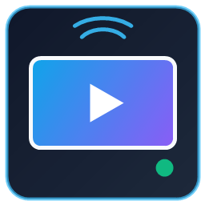

<p align="center">
  
</p>

<h1 align="center">Mobile Game Streamer Toolkit</h1>

<p align="center">
  <strong>Native OBS Studio input plugin for low-latency Android <code>scrcpy</code> capture, Apple AirPlay 2 screen mirroring, and session-only iPhone USB Reverse Tethering.</strong>
</p>

<p align="center">
  <a href="https://github.com/spectralAV/mobile-game-streamer-toolkit/actions/workflows/ci.yml"></a>
  <a href="https://github.com/spectralAV/mobile-game-streamer-toolkit/actions/workflows/release-package.yml"></a>
  <a href="https://github.com/spectralAV/mobile-game-streamer-toolkit/releases"></a>
  <a href="LICENSE"></a>
  <a href="https://streamelements.com/martianost/tip"></a>
  
  
  
</p>

<p align="center">
  <a href="#quickstart">Quickstart</a> |
  <a href="#device-setup-guide">Device Setup</a> |
  <a href="#install-options">Install Options</a> |
  <a href="#capabilities">Capabilities</a> |
  <a href="#iphone-usb-reverse-tethering">USB Tethering</a> |
  <a href="#documentation">Docs</a> |
  <a href="#roadmap">Roadmap</a> |
  <a href="#contributors">Contributors</a> |
  <a href="#community-and-support">Support</a>
</p>

Mobile Game Streamer Toolkit (`obs-scrcpy-source`) is a native Windows x64 OBS Studio plugin built for mobile esports creators and broadcast setups. Instead of capturing external desktop windows or dealing with Wi-Fi jitter, it decodes Android `scrcpy` sockets and Apple AirPlay 2 streams directly inside OBS Studio using hardware-accelerated FFmpeg (`D3D11VA`), outputs synchronized low-latency video and audio frames via `obs_source_output_video()` / `obs_source_output_audio()`, and optionally bridges live frames directly to [MLBB Co-Pilot](https://github.com/spectralAV/mlbb-co-pilot).

The project is actively progressing toward `1.0.0`. Current release: [`v0.3.6`](https://github.com/spectralAV/mobile-game-streamer-toolkit/releases/tag/v0.3.6).

Planning and guides: [Install Guide](docs/installing-toolkit.md) · [Architecture](docs/ARCHITECTURE.md) · [Roadmap to 1.0.0](docs/roadmap-1.0.md) · [Known Limitations](docs/known-limitations.md)

## Status

| Area | Current state |
| --- | --- |
| Primary platform | Windows 10 / 11 (x64) with OBS Studio 30+ / 32+ |
| Android capture | Native headless `scrcpy` 4.0 / 4.1 socket transport (`H.264`, `H.265`, `AV1`, `VP8`, `VP9` + `Opus`, `AAC`, `FLAC`, raw PCM) |
| Apple capture | Embedded AirPlay 2 receiver (`1080p`, `1440p`, `4K`, `Portrait 2K`, `Portrait 4K`) + gameplay audio |
| iPhone USB cable mode | Session-only CDC-NCM USB Reverse Tethering (`192.168.137.1` ICS) with full automatic revert to stock Apple drivers |
| Zero-config installer | Inno Setup `.exe` bundling `scrcpy 4.1`, FFmpeg 8.0.1 `D3D11VA`, Apple Bonjour, Apple Mobile Device Support, WHQL USB/NCM drivers & Firewall rules |
| Package registry | GHCR OCI plugin binary package (`ghcr.io/spectralav/mobile-game-streamer-toolkit`) |
| CV integration | Optional background latest-frame BGRA bridge to `http://127.0.0.1:8787/api/capture/obs/frame.raw` for [MLBB Co-Pilot](https://github.com/spectralAV/mlbb-co-pilot) |

## Quickstart

### End-User Zero-Config Setup (Recommended)

1. Download **`obs-scrcpy-source-0.3.6-windows-x64-Installer.exe`** from [GitHub Releases](https://github.com/spectralAV/mobile-game-streamer-toolkit/releases/latest).
2. Close OBS Studio and run the installer (all required runtimes, Apple Bonjour, Apple USB/NCM drivers, and Windows Firewall rules are configured out of the box).
3. Prepare your phone/tablet using the [Device Setup Guide](#device-setup-guide) below, then open OBS Studio, click **`+`** under **Sources**, and add:
   - **scrcpy Device Source** for Android USB / TCP-IP capture, or
   - **Apple AirPlay Source** for iPhone, iPad, or Mac screen mirroring (over 5 GHz Wi-Fi or direct USB Reverse Tethering).

### Build From Source

```powershell
git clone https://github.com/spectralAV/mobile-game-streamer-toolkit.git
cd mobile-game-streamer-toolkit
.\scripts\configure-build.ps1 -Build -Configuration RelWithDebInfo
ctest --test-dir build -C RelWithDebInfo --output-on-failure
```

Install the built plugin into your local OBS Studio installation (close OBS Studio first):

```powershell
.\scripts\install-global-plugin.ps1
```

For full setup and troubleshooting details, see [Installing Mobile Game Streamer Toolkit](docs/installing-toolkit.md).

## Device Setup Guide

Mobile operating systems block external screen capture by default for security. Complete this quick setup on your device so OBS Studio can receive gameplay video and audio:

### 1. Android Setup (`scrcpy Device Source` — Requires USB Debugging)

`scrcpy` communicates with Android over **ADB (`Android Debug Bridge`)**, which requires unlocking hidden **Developer options** and turning on **USB debugging** once on your phone:

1. **Unlock hidden Developer options**:
   Open **Settings** on your Android phone, locate your build/OS version entry in the table below, **tap it 7 times quickly**, and enter your lock-screen PIN/pattern when prompted until you see *"You are now a developer!"*.

   | Phone Brand | Where to tap 7 times | Where Developer options appears | Brand-specific note |
   | --- | --- | --- | --- |
   | **Google Pixel / Stock Android** | `Settings -> About phone -> Build number` | `Settings -> System -> Developer options` | — |
   | **Samsung Galaxy (One UI)** | `Settings -> About phone -> Software information -> Build number` | `Settings -> Developer options` (at the bottom of Settings) | On **One UI 6+**, if **USB debugging** is grayed out, open `Settings -> Security and privacy -> Auto Blocker` and turn **Auto Blocker OFF** |
   | **Xiaomi / POCO / Redmi (HyperOS / MIUI)** | `Settings -> About phone -> OS version` *(or `MIUI version`)* | `Settings -> Additional settings -> Developer options` | Only standard **USB debugging** is needed (read-only capture does **not** require *USB debugging (Security settings)*) |
   | **OnePlus / OPPO / Realme / ASUS ROG** | `Settings -> About device -> Version -> Version number` *(ROG: `Software information -> Build number`)* | `Settings -> Additional settings` *(or `System`)* `-> Developer options` | Turn on **Disable adb authorization timeout** if available so permission stays permanent |

2. **Turn ON USB debugging**:
   Open **Developer options**, scroll down to **Debugging**, toggle **USB debugging** **ON**, and tap **OK** to confirm.
3. **Connect via USB data cable & tap Allow**:
   - Plug your phone into your PC using a **USB data cable** *(many power-bank or accessory cables are charge-only and have no data wires)*.
   - Keep your phone **unlocked**, check **"Always allow from this computer"**, and tap **Allow** on the **"Allow USB debugging?"** popup. *(If no popup appears, swipe down your notification shade, tap the USB charging notification, and switch USB mode to **File Transfer / Android Auto** or **PTP**.)*
4. **Select your phone in OBS Studio**:
   - Add **scrcpy Device Source**, click **Refresh devices**, and choose your phone under **Device serial** (or leave on `Auto USB device`).
   - *Optional Wireless (`TCP/IP`) mode*: Once authorized over USB, run `"C:\Program Files\scrcpy\4.1\adb.exe" tcpip 5555` (or enable **Wireless debugging**), set **Connection** to `TCP/IP`, and enter `<phone-ip>:5555`.

### 2. Apple iPhone / iPad / Mac Setup (`Apple AirPlay Source` — Control Center Screen Mirroring)

Unlike capture cards or Android `scrcpy`, Apple devices **never** start streaming automatically just from plugging in a cable or adding the OBS source. You always start the stream from your Apple device's **Control Center (quick settings bar)** using **Screen Mirroring**:

#### Option A — Wireless AirPlay (5 GHz Wi-Fi / LAN)

1. Connect your iPhone/iPad/Mac and your Windows PC to the **same local network** (5 GHz Wi-Fi or wired Ethernet on the same router/subnet; avoid isolated "Guest" Wi-Fi networks).
2. In OBS Studio, add **Apple AirPlay Source**, check **Enable AirPlay receiver**, and click **OK** (default receiver name: **`OBS AirPlay`**).
3. Open **Control Center (quick settings bar)** on your Apple device:
   - **iPhone (Face ID) & modern iPad**: **Swipe down from the top-right corner** of the screen (where the battery and Wi-Fi icons sit).
   - **iPhone SE / Home-button models**: **Swipe up from the bottom edge** of the screen.
   - **Mac (macOS)**: Click the **Control Center** icon (two pill toggles) in the top-right menu bar.
4. Tap the **Screen Mirroring** button *(icon with two overlapping rectangles)* and tap **`OBS AirPlay`**. Gameplay video and audio will appear in OBS immediately.

#### Option B — Zero-Lag USB Cable (iPhone USB Reverse Tethering)

1. Plug your iPhone into your PC with a Lightning or USB-C data cable, **unlock the iPhone**, and tap **Trust** (plus enter your passcode) if **"Trust This Computer?"** appears.
2. In OBS Studio, open **Apple AirPlay Source** properties and check **both**:
   - **Enable AirPlay receiver**
   - **Enable iPhone USB Reverse Tethering (Zero-Lag / Direct Cable)**
3. Wait 3–5 seconds (click **Refresh USB Status** to confirm status is **`Active`** — your iPhone now uses a private direct USB Ethernet tunnel to your PC).
4. **Start Screen Mirroring on your iPhone**: Even over USB cable, **swipe down from the top-right corner** of your iPhone to open **Control Center (quick settings bar)** -> tap **Screen Mirroring** (two overlapping rectangles) -> select **`OBS AirPlay`**.
5. **To stop streaming**: Open **Control Center -> Screen Mirroring -> Stop Mirroring**. Uncheck **Enable iPhone USB Reverse Tethering** (or close OBS) to immediately revert your iPhone to stock Apple USB mode.

## Install Options

| Path | Artifact / Command | Notes |
| --- | --- | --- |
| Windows Installer | [`obs-scrcpy-source-0.3.6-windows-x64-Installer.exe`](https://github.com/spectralAV/mobile-game-streamer-toolkit/releases/latest) | Recommended zero-config install with optional checkboxes for Bonjour, Apple USB/NCM drivers & Firewall rules |
| Portable ZIP | [`obs-scrcpy-source-0.3.6-windows-x64.zip`](https://github.com/spectralAV/mobile-game-streamer-toolkit/releases/latest) | For portable OBS Studio setups; includes `redist\setup-prerequisites.ps1` |
| Source development | `.\scripts\configure-build.ps1 -Build` then `.\scripts\install-global-plugin.ps1` | Automatically fetches OBS 32.1.2 & FFmpeg 8.0.1 SDK headers/libs |
| GHCR OCI package | `ghcr.io/spectralav/mobile-game-streamer-toolkit:latest` | Lightweight OCI artifact containing compiled Windows x64 plugin & helper binaries |

GHCR package tags:

```text
ghcr.io/spectralav/mobile-game-streamer-toolkit:latest
ghcr.io/spectralav/mobile-game-streamer-toolkit:0.3.6
ghcr.io/spectralav/mobile-game-streamer-toolkit:v0.3.6
```

## Capabilities

| Capability | What it does |
| --- | --- |
| Headless `scrcpy` source | Deploys `scrcpy-server` in read-only mode over `adb reverse`, decodes compressed video/audio directly in OBS without spawning a desktop window |
| Hardware-accelerated decode | Uses FFmpeg 8.0.1 `D3D11VA` GPU decoding (`H.264`, `HEVC`, `AV1` / `dav1d`) with live-edge latency catchup and shared device PTS audio-video sync |
| Rotation & reconnect resilience | Handles live portrait/landscape rotation without stream crashes and automatically recovers dropped ADB/decoder sessions with exponential backoff |
| Embedded Apple AirPlay 2 | Hosts an in-process AirPlay receiver inside OBS with Annex B SPS/PPS caching, contiguous frame memory safety, and `1080p` / `1440p` / `4K` / vertical presets |
| iPhone USB Reverse Tethering | Switches a USB-connected iPhone to CDC-NCM USB Ethernet and shares PC internet via ICS for zero-Wi-Fi-jitter AirPlay over cable |
| Scalable disconnected placeholder | Displays a clean, aspect-aware status frame while waiting for a phone connection or reconnect |
| MLBB Co-Pilot CV bridge | Publishes throttled raw BGRA frames on a non-blocking worker thread to `127.0.0.1:8787` so MLBB Co-Pilot analyzes the exact OBS feed without a second capture session |

## iPhone USB Reverse Tethering

To stream AirPlay over a direct USB cable without Wi-Fi congestion, check **Enable iPhone USB Reverse Tethering** inside **Apple AirPlay Source** properties.

The plugin enforces a strict **session-only driver lifecycle** so your iPhone always behaves like a normal Apple device whenever OBS tethering is not in use:

- **When OBS is closed or USB Reverse Tethering is unchecked**:
  - `libusb0.sys` remains completely dormant (`SERVICE_DEMAND_START`) and is **not** attached to any Apple USB device.
  - Your iPhone runs **100% unmodified stock Apple drivers** (`usbccgp` + `AppleLowerFilter`, `OriginalConfigurationValue = 2`), keeping **Windows Photos**, **File Explorer**, **iTunes**, **Apple Devices**, and backups/sync working exactly as Apple intended.
- **Only while USB Reverse Tethering is actively enabled in OBS**:
  - `obs-airplay-tether-helper.exe` temporarily attaches `libusb0` to the composite parent node, sends vendor `SET_MODE` to activate Apple CDC-NCM USB Ethernet, suppresses photo popups during your stream, and enables Windows ICS (`192.168.137.1`).
- **Immediately when unchecked, source is removed, OBS closes, or OBS crashes**:
  - Disables ICS, sends `SET_MODE 2`, strips `libusb0` from `UpperFilters`, restores stock Apple `Device Parameters` and `AppleLowerFilter`, re-enables the Photo/PTP interface, restarts the USB node so pure Apple drivers reload immediately, and exits the helper process.

## Architecture

| Path | Purpose |
| --- | --- |
| `src/plugin-main.cpp` | OBS module entry point registering `obs_scrcpy_source` and `obs_airplay_source` |
| `src/scrcpy-source.cpp` & `src/scrcpy-runtime.cpp` | Android ADB device discovery, encoder probing, `scrcpy` 4.0/4.1 socket lifecycle, FFmpeg `D3D11VA` decode & MLBB Co-Pilot CV frame bridge |
| `src/scrcpy-low-latency.cpp` & `src/scrcpy-command.cpp` | Live-edge PTS drift/backlog control and version-aware `scrcpy-server` argument builder |
| `src/airplay-source.cpp` & `src/airplay-runtime.cpp` | OBS AirPlay source properties, dynamic `airplay2dll` receiver host, Annex B H.264 decoder (`src/airplay-h264.cpp`), and audio/video frame delivery |
| `src/iphone-tether.cpp` & `src/iphone-tether-helper.cpp` | Elevated named-pipe helper managing session-only `libusb0` composite filtering, CDC-NCM mode switching, ICS sharing, and full stock Apple driver restoration |
| `src/iphone-tether-client.cpp` | Non-blocking OBS client communicating with `\\.\pipe\obs-airplay-tether` |
| `installer/` | Inno Setup installer definition (`obs-scrcpy-source.iss`), idempotent prerequisite setup (`setup-prerequisites.ps1`), and post-install quickstart |
| `scripts/` | Toolchain discovery, OBS/FFmpeg SDK setup, CMake build wrapper, local OBS install scripts, and release packager (`build-installer.ps1`) |
| `tests/` | Standalone C++ unit tests for `scrcpy` commands, low-latency sync, disconnected frames, AirPlay H.264 NAL framing, pixel formats, and log filtering |

## Developer Commands

| Command | Purpose |
| --- | --- |
| `.\scripts\validate-environment.ps1` | Check local OBS, `scrcpy`, ADB, and Visual Studio build prerequisites |
| `.\scripts\probe-encoders.ps1` | List hardware/software encoders reported by a connected Android device |
| `.\scripts\configure-build.ps1` | Download/prepare OBS 32.1.2 & FFmpeg 8.0.1 SDK shims and configure CMake |
| `.\scripts\configure-build.ps1 -Build -Configuration RelWithDebInfo` | Compile `obs-scrcpy-source.dll`, `obs-airplay-tether-helper.exe`, and unit tests |
| `ctest --test-dir build -C RelWithDebInfo --output-on-failure` | Run all 6 C++ unit test suites |
| `.\scripts\install-global-plugin.ps1` | Install built plugin into `C:\Program Files\obs-studio` (requires elevation) |
| `.\scripts\install-user-plugin.ps1` | Install built plugin into `%APPDATA%\obs-studio\plugins` |
| `.\scripts\build-installer.ps1 -Build` | Stage full runtime + prerequisites and build Inno Setup `.exe` & portable `.zip` in `release\` |

## Documentation

| Document | Purpose |
| --- | --- |
| [Installing Toolkit](docs/installing-toolkit.md) | End-to-end installer, portable ZIP, source build, Android ADB, and AirPlay / USB setup |
| [Architecture](docs/ARCHITECTURE.md) | Internal pipeline overview for `scrcpy` socket decoding, AirPlay callbacks, and threading |
| [Roadmap To 1.0.0](docs/roadmap-1.0.md) | Planned milestones from `0.3.x` through `1.0.0` |
| [Known Limitations](docs/known-limitations.md) | Platform requirements, DRM boundaries, and Windows ICS notes |
| [Support Guide](docs/support.md) | How to collect OBS, prerequisite, ADB, and USB tethering logs safely |

## Roadmap

| Milestone | Goal |
| --- | --- |
| `0.3.x` | Native `scrcpy 4.1` + AirPlay 2 sources, zero-config Windows installer with Bonjour & Apple WHQL drivers, and session-only iPhone USB Reverse Tethering (**Current: `v0.3.6`**) |
| `0.4.x` | Multi-device iPhone USB selector, explicit AirPlay network adapter binding, and richer in-OBS diagnostics |
| `0.5.x` | Zero-copy `D3D11` GPU shared texture output into OBS graphics (`gs_texture_t`) for minimal 4K60 overhead |
| `0.8.x` | Authenticode-signed plugin/helper/installer binaries and automated loopback integration tests |
| `1.0.0` | Production release with finalized settings schema, multi-language locales, and full Windows 10/11 QA matrix |

## Contributors

- **[@spectralAV](https://github.com/spectralAV)** — Creator, lead developer, architecture, OBS plugin engineering, AirPlay & iPhone USB Reverse Tethering runtime, and Windows packaging.

Contributions are welcome — see [CONTRIBUTING.md](CONTRIBUTING.md) to get started.

## Community And Support

- Use [GitHub Issues](https://github.com/spectralAV/mobile-game-streamer-toolkit/issues/new/choose) for bug reports, feature requests, documentation updates, and device stream / USB tethering diagnostics.
- Support the project with an optional tip through [StreamElements](https://streamelements.com/martianost/tip).
- Read [CONTRIBUTING.md](CONTRIBUTING.md) before opening a pull request.
- Read [SECURITY.md](SECURITY.md) before reporting a vulnerability.
- Redact personal device serials, UDIDs, tokens, and private captures before sharing logs publicly.

## Legal

Copyright 2026 SpectralAV.

Mobile Game Streamer Toolkit is an independent open-source project and is not affiliated with, endorsed by, sponsored by, or approved by Apple Inc., Google LLC, Genymobile, or the OBS Project.

Original project source code is licensed under the **Apache License, Version 2.0**. Third-party libraries, headers, drivers, and bundled runtime components (`libobs`, `FFmpeg`, `scrcpy`, `libusb-win32`, `AirPlayServer`, and Apple system redistributables) remain governed by their respective upstream licenses and terms. See [LICENSE](LICENSE) and [NOTICE](NOTICE).
